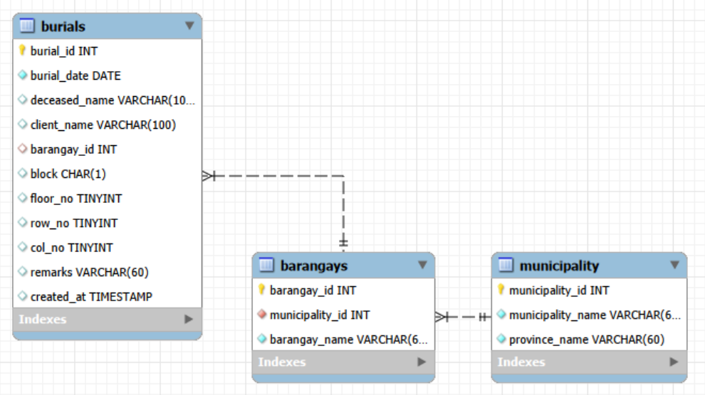
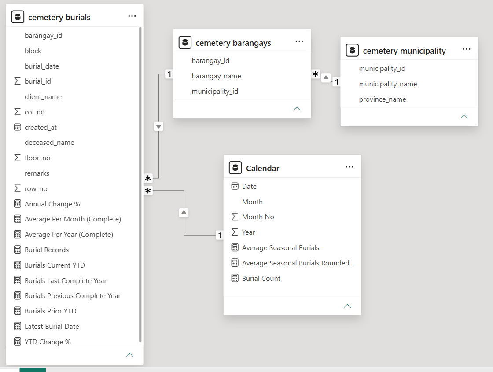
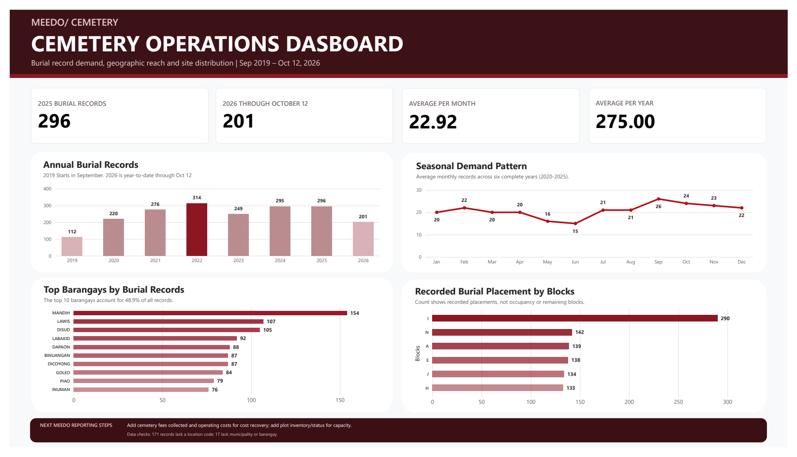

# Cemetery Operations Dashboard — LGU Sindangan MEEDO

Cleaned and standardized **1,963 cemetery records** in Excel, loaded them into a relational MySQL database, and built a Power BI dashboard for the **LGU Sindangan Municipal Economic Enterprise Development Office (MEEDO)**. Added DAX measures for record volume, seasonal and complete-period averages, and year-to-date and annual comparisons. The dashboard summarizes activity by time and location and highlights incomplete location data for review.

## Project Objective

To turn a spreadsheet of cemetery records into a consistent reporting model and an interactive dashboard that helps MEEDO review historical activity, compare patterns across locations, and identify records that may need follow-up.

## Dataset Used

The analysis covers **1,963 records** from **September 2019 through October 12, 2026**. The cleaned Excel table includes burial dates, administrative geography, placement fields, remarks, and derived year and month fields. The source workbook also preserves a raw sheet, source-row references, cleaning notes, correction logs, a barangay mapping table, and validation settings.

The row-level workbook is not included in this public repository because it contains personal names and detailed burial-location fields.

### Geographic and time coverage

- Records begin in September 2019, so 2019 is a partial year.
- 2026 figures run through October 12 and are year-to-date.
- The report summarizes records by barangay, municipality, province, and cemetery block.

## Data Cleaning and Preparation

1. Reshaped the source rows into a flat table with one header row and preserved the original row number so cleaned records could be traced back to the source.
2. Standardized text by removing extra and non-breaking spaces and normalizing case.
3. Corrected **51 dates stored as text** and fixed year typos through a separate fixes log with source-row references instead of silently overwriting the source.
4. Standardized barangay names with a mapping table after extracting the locality from the address field.
5. Normalized block, floor, row, and column values; moved nonstandard block text into remarks and left unknown location values blank.
6. Applied configured ranges for blocks, floors, rows, and columns, and flagged out-of-range or repeated values for review instead of deleting records.

## MySQL Database Design

Loaded the cleaned records into MySQL and organized them into related tables:

- `burials` stores each record, its date, placement fields, remarks, and barangay key.
- `barangays` stores each barangay and its municipality key.
- `municipality` stores municipality and province names.

Foreign-key relationships connect burial records to barangays and barangays to municipalities. A joined view brings the geographic labels together for analysis while keeping the location tables separate.

## Power BI Model and DAX

Built a Power BI model with burial, barangay, municipality, and calendar tables, related by their date and location keys. Added DAX measures including `Burial Records`, `Latest Burial Date`, `Burials Current YTD`, `Burials Prior YTD`, `Burials Last Complete Year`, `Burials Previous Complete Year`, `YTD Change %`, `Annual Change %`, `Average Per Month (Complete)`, `Average Per Year (Complete)`, and seasonal averages by month.

These measures distinguish complete reporting periods from partial years and support comparisons over time.

## Questions and KPIs

1. How has recorded activity changed year to year?
2. Which months and barangays account for the most records?
3. How are recorded placements distributed across blocks?
4. Which records need location details reviewed?

**Core measures:** burial records, current and prior year-to-date records, annual change, complete-year averages, seasonal averages, barangay counts, block placement counts, and missing-location counts.

## Dashboard Overview

The report shows annual burial records, seasonal demand patterns, the ten barangays with the most records, and recorded placements by block. It distinguishes complete years from partial periods and notes that block counts represent recorded placements, not occupancy or remaining capacity.

[Open the full dashboard PDF](cemetery-operations-dashboard.pdf).

The PNG below is a preview of the same one-page report; the PDF is provided as a downloadable version.

## Project Insights

- The ten most active barangays account for **48.9%** of all records.
- Annual records peaked at **314 in 2022**. There were **296 in 2025** and **201 through October 12, 2026**; 2026 is a partial year.
- Across complete years 2020–2025, the dashboard reports an average of **275 records per year** and **22.92 per month**.
- **171 records** are missing a location code, and **17 records** are missing a municipality or barangay value.

These checks identify location fields that can be prioritized for review. Recorded placements by block should not be interpreted as current occupancy or available capacity.

## Tools

Microsoft Excel · MySQL Workbench · MySQL · Power BI · DAX

## Files in this repository

- `README.md` — project summary, data preparation, model, measures, and findings
- `dashboard-preview.png` — aggregate dashboard image
- `cemetery-operations-dashboard.pdf` — aggregate dashboard report
- `mysql-schema.png` — MySQL table relationship diagram
- `powerbi-model.png` — Power BI model and measures screenshot

## Privacy

This repository contains only the aggregate dashboard and its preview. It does not include the row-level CSV, Excel workbook, SQL source files, or editable Power BI file because the underlying materials contain personal names and detailed burial-location information.
